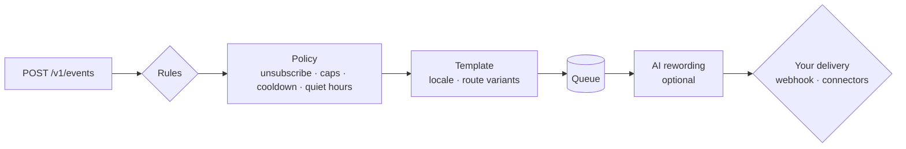

<div align="center">

# Cue

Per-person attention budgets for AI agents and background automations, self-hosted.

[](https://github.com/murtazox04/Cue/actions/workflows/ci.yml)
[](https://pypi.org/project/cue-notify/)
[](https://github.com/murtazox04/Cue/blob/main/LICENSE)
[](https://glama.ai/mcp/servers/murtazox04/Cue)

[Documentation](https://murtazox04.github.io/Cue/) ·
[Getting started](https://murtazox04.github.io/Cue/getting-started/) ·
[Agents](https://murtazox04.github.io/Cue/concepts/agents/)


</div>

A code-review agent, a log-triage agent and a billing agent can all page the same
engineer at 2 a.m. A LangGraph `interrupt()` or a Slack approve button pauses one agent;
none of them knows what the others already sent. Cue sits in front of all of them as
the outbound gatekeeper:

- **Budgets per agent, per person.** Each agent sends with its own key. Its
  `frequency_caps` limit how many messages it may send one person per period, and
  messages over budget are stored as `suppressed` with reason `agent_budget`. Category
  caps count what a person gets from every sender together.
- **Quiet hours in the person's time zone.** A message due inside someone's quiet hours
  waits until they end. Only `critical` messages in categories people cannot unsubscribe
  from break through, and each agent's `max_importance` caps what it may claim, so only
  agents you trust can use `critical`.
- **Digests for the rest.** A digest rule turns a stream of agent events into one
  message per window, or one per day at a local time.
- **Approval for risky messages.** Messages that match an agent's `approval` condition
  wait as `pending_approval`; a reviewer decides from a one-time link in their own
  notification. Agent keys can never approve.
- **A reason for every outcome.** Each message has a status and a `status_reason`, and
  each event records which rules matched and why. Agents connect over HTTP, the SDKs or
  the [MCP server](https://murtazox04.github.io/Cue/guides/ai-agents/).

The recording above is [`examples/agents-demo`](https://github.com/murtazox04/Cue/tree/main/examples/agents-demo):
from a checkout, `uv run python examples/agents-demo/demo.py` runs it with SQLite and
the console connector.

## Quick start

With Docker Compose (PostgreSQL, an API and a worker; messages go to the worker's log):

```bash
git clone https://github.com/murtazox04/Cue && cd Cue
docker compose up --build -d
docker compose exec api cuectl keys create admin
docker compose logs -f worker
```

Or with Python 3.12+ and SQLite, in a virtual environment:

```bash
python -m venv .venv && . .venv/bin/activate
pip install cue-notify
export CUE_WORKER__EMBEDDED=true
export CUE_CHANNELS__PUSH__PROVIDER=console CUE_CHANNELS__SMS__PROVIDER=console
cuectl db upgrade && cuectl keys create admin && cuectl serve
```

`keys create` prints an API key once; keep it as `CUE_API_KEY`. Then follow the
[getting-started guide](https://murtazox04.github.io/Cue/getting-started/) to create a
template and a rule and send an event that shows up in the log, and
[agents](https://murtazox04.github.io/Cue/concepts/agents/) to give an agent its own key
and limits.

To try it without installing anything, with [uv](https://docs.astral.sh/uv/):

```bash
CUE_WORKER__EMBEDDED=true CUE_CHANNELS__PUSH__PROVIDER=console \
  CUE_CHANNELS__SMS__PROVIDER=console uvx cue-notify serve --migrate
```

and, in a second terminal in the same directory (both use `./cue.db`),
`uvx cue-notify keys create admin`.

## More for agents

- **Agents as senders.** Each agent gets its own key with a per-person attention budget,
  an importance ceiling and, where you want it, human approval before anything goes out.
  Agent keys cannot read or change people's profiles, and cannot approve anything. See
  [agents](https://murtazox04.github.io/Cue/concepts/agents/).
- **Ask a person first.** Before a risky action (a refund, a deletion, a mass e-mail), an
  agent calls `POST /v1/approvals` or the `request_approval` MCP tool. Cue tells the
  reviewers on their own channels with a one-time link and reports the decision back,
  with bridges for LangGraph, Pydantic AI, CrewAI Flows and Dapr Agents. See
  [approval requests](https://murtazox04.github.io/Cue/concepts/approvals/).
- **MCP server.** `uvx cue-notify mcp` gives Claude, Cursor or your own agent tools to
  notify people and inspect delivery, under the same policy and audit trail. See
  [AI agents (MCP)](https://murtazox04.github.io/Cue/guides/ai-agents/).
- **Screening (optional, off by default, experimental).** With `[screening] enabled =
  true` and a TypeSafe API key, a decision model ([Jev](https://docs.typesafe.ai)) reads
  each agent message before it is sent: pressure, deception or leaked secrets hold it for
  a person, and overstated importance is lowered. Built against TypeSafe's published
  API; not yet proven in production. Your own backend's messages are never screened.
- **Coding agents.** `cue-hook` lets OpenHands and Claude Code tell you when they finish
  or wait for input. See [coding agents](https://murtazox04.github.io/Cue/guides/coding-agents/).
- **Claude Code plugin.** `/plugin marketplace add murtazox04/Cue`, then
  `/plugin install cue@cue`, adds a skill for integrating Cue into an application.

## Notifications from your own backend

The same policy serves your product's own notifications. Your backend reports what
happened (`order.shipped`, `payment.failed`). Cue decides whether that is worth a
notification, renders it in the person's language, picks the time and the route, and
hands a finished message to the delivery you connect: your own sending service through a
signed webhook, or a bundled connector.

- **Rules and policy in one place.** JSON Logic rules map events to templates; every
  message, whether triggered by a rule, sent directly or broadcast, passes the same
  checks: unsubscribes, muted channels, frequency caps, cooldowns and quiet hours in the
  recipient's own time zone, checked again right before sending.
- **Fewer messages.** Digests turn a burst of events into one message per window or one
  per day at a local time, and fatigue backs off from people who stopped engaging.
- **People in control.** A hosted preference page (or a JSON API for your own), RFC 8058
  one-click unsubscribe, and a consent ledger of every change.
- **Answers.** Every event records which rules matched and why; every message records its
  status and the reason it was suppressed or failed.

```bash
curl -X POST https://cue.example.com/v1/events \
  -H "Authorization: Bearer $CUE_API_KEY" -H "Content-Type: application/json" \
  -d '{"name": "order.shipped", "recipient": "customer-42",
       "data": {"order_id": "1001"}, "idempotency_key": "order-1001-shipped"}'
```

Your delivery endpoint then receives a signed, fully rendered message:

```json
{
  "id": "01a1…",
  "channel": "push",
  "address": "<device token>",
  "locale": "en",
  "importance": "normal",
  "expires_at": null,
  "content": {"title": "Your order is on its way", "body": "Order 1001 ships today.",
              "url": "https://shop.example/orders/1001"},
  "metadata": {"cue_message_id": "01a1…", "cue_tracking_token": "…"},
  "links": {"preferences": "https://cue.example.com/preferences/…"}
}
```

## Who it's for

**For** teams whose agents, background jobs or product code send push, e-mail, SMS or
chat messages to people, and who want the decisions (whether, when, how often, over
which route, in which language) made in one place, stored, and explainable, on their
own infrastructure.

**Not for you (yet) if** you need:

- an in-app inbox or notification feed: planned, not built;
- an admin UI: today you configure Cue through the HTTP API, the CLI and `cue.toml`;
- a connector Cue does not have yet. Today's are FCM, APNs, Twilio, SMTP, Amazon SES,
  Resend, Slack, Telegram, a signed webhook and console, plus any you write;
- a hosted service: Cue is self-hosted only;
- a visual journey builder for marketing campaigns: not planned.

See the [roadmap](https://github.com/murtazox04/Cue/blob/main/ROADMAP.md).

## Bring your own delivery

Each route (`push`, `sms`, `email`, `ops-alerts`…) is backed by a **connector**:

| Connector | Use it when |
|---|---|
| `webhook` | You already have a sending service, or want full control. Cue POSTs signed JSON to it. |
| `fcm`, `twilio`, `smtp`, `telegram` | You want a ready-made connector for these providers. |
| `console` | Local development: messages are logged. |
| your own | Write a small class and register it as a plugin; see [custom connectors](https://murtazox04.github.io/Cue/guides/custom-channels/). |

Connectors are configuration, not code changes: swap SMS vendors without touching a
rule.

## Also

- **SDKs.** `pip install cue-notify-client` and `npm install cue-client`, both with
  webhook signature verification. See [SDKs](https://murtazox04.github.io/Cue/guides/sdks/).
- **Engagement tracking.** Delivered, opened, clicked, converted; client apps report with
  a per-message token, no API key needed.
- **Broadcasts.** Audience filters, resumable batches, pause/resume/cancel without double
  sends.
- **Compliance.** US texting hours and state caps for marketing texts, STOP/START
  replies, and opt-in records with the disclosure shown. See
  [compliance](https://murtazox04.github.io/Cue/guides/compliance/).
- **Runs on your database.** An API process and a worker process (or the worker embedded
  in the API for small installs), with PostgreSQL or SQLite. No Redis or message broker:
  the durable job queue lives in the database. Schedule `cuectl prune` yourself for
  retention.
- **Observable.** Per-rule event outcomes, status reasons, Prometheus metrics, JSON logs.
- **Docs for tools.** [`llms.txt`](https://murtazox04.github.io/Cue/llms.txt) and
  [`AGENTS.md`](https://github.com/murtazox04/Cue/blob/main/AGENTS.md).

## How Cue compares

| | What it is | Difference from Cue |
|---|---|---|
| [Novu](https://novu.co) | Notification infrastructure you can self-host. | Its [self-hosting guide](https://docs.novu.co/community/self-hosting-novu/overview) lists MongoDB, Redis and S3-compatible storage. Cue needs one database, PostgreSQL or SQLite. |
| Knock, Courier, OneSignal | Hosted notification services. | You sign up for their service; Cue runs on your infrastructure. |
| Apprise, ntfy | Tools that deliver a message to many services or devices. | They send what you hand them; whether and when a person should be notified (preferences, caps, quiet hours in their time zone, digests) is left to your code. Cue makes that decision, then hands the message to a sender. |
| Human approval inside an agent framework (LangGraph `interrupt()`, a Slack approve button) | A pause in one agent's run until a person answers. | It covers one agent and one decision; how many messages a person already got from your other agents tonight is not its concern. Cue applies budgets, quiet hours and digests across all of them, and its [approval requests](https://murtazox04.github.io/Cue/concepts/approvals/) can resume LangGraph, Pydantic AI, CrewAI Flows and Dapr Agents. |
| Framework notification libraries (Laravel, Rails, Django…) | Code in your application that formats and sends notifications. | Policy, preferences and history are yours to build per application; Cue keeps them in one service that every application and agent calls. |

## How it works



| Concept | In one line |
|---|---|
| **Event** | Something that happened to a recipient. Idempotent, stored with per-rule outcomes. |
| **Rule** | When event X (and condition) → send template Y over routes [A, B]. |
| **Template** | Localised content with route-specific variants. |
| **Category** | Policy bundle: frequency caps, quiet hours, whether unsubscribing is allowed. |
| **Channel** | A named route (`push`, `sms`…) backed by a connector. |
| **Message** | One notification to one recipient, with a full status trail. |
| **Broadcast** | One template to an audience, in resumable batches. |

## Configuration

Environment variables (`CUE_SECTION__KEY`) or a `cue.toml`:

```toml
[database]
url = "postgresql+asyncpg://cue:secret@db/cue"

[api]
public_url = "https://cue.example.com"   # needs CUE_API__SECRET_KEY

[channels.push]
provider = "webhook"
url = "https://notifications.internal.example/push"   # secret from CUE_CHANNELS__PUSH__SECRET

[channels.sms]
provider = "twilio"
account_sid = "AC…"
from_number = "+15550100"   # auth token from CUE_CHANNELS__SMS__AUTH_TOKEN
```

See the [configuration reference](https://murtazox04.github.io/Cue/reference/configuration/),
[deployment](https://murtazox04.github.io/Cue/guides/deployment/) and
[`examples/cue.toml`](https://github.com/murtazox04/Cue/blob/main/examples/cue.toml).

## Project status

Cue is in early development (0.x): the model and API are stable in shape but may still
change before 1.0; each release's [changelog](https://github.com/murtazox04/Cue/blob/main/CHANGELOG.md)
says what to do when upgrading. See the
[roadmap](https://github.com/murtazox04/Cue/blob/main/ROADMAP.md) for what comes next.
Feedback and contributions are welcome; see
[CONTRIBUTING.md](https://github.com/murtazox04/Cue/blob/main/CONTRIBUTING.md).

## License

[MIT](https://github.com/murtazox04/Cue/blob/main/LICENSE)

<!-- mcp-name: io.github.murtazox04/cue -->
