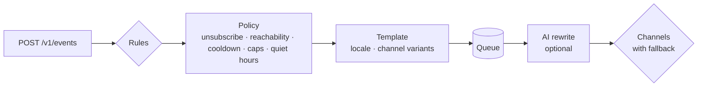

<div align="center">

# Cue

**Self-hosted notification orchestration.**<br/>
Events in — the right message out, on the right channel, at the right time.

[](https://github.com/murtazox04/Cue/actions/workflows/ci.yml)
[](pyproject.toml)
[](LICENSE)

[Documentation](https://murtazox04.github.io/Cue) ·
[Getting started](docs/getting-started.md) ·
[Architecture](docs/architecture.md)

</div>

---

Your backend reports what happened — `order.shipped`, `payment.failed`,
`user.signed_up`. Cue decides **whether** to notify, **what** to say in the
recipient's language, **when** (respecting their time zone and quiet hours) and
**where** (push, SMS, e-mail, Telegram, webhooks — with fallback), and records exactly
why for every decision.

```bash
curl -X POST https://cue.example.com/v1/events \
  -H "Authorization: Bearer $CUE_KEY" -H "Content-Type: application/json" \
  -d '{"name": "order.shipped", "recipient": "customer-42",
       "data": {"order_id": "1001"}, "idempotency_key": "order-1001-shipped"}'
```

## Features

- **Rules, not code** — JSON Logic conditions, wildcards, priorities, delays, cooldowns,
  deterministic percentage rollouts and a dry-run endpoint.
- **Policy on every send** — unsubscribes, muted channels, rolling frequency caps and
  quiet hours in each recipient's time zone; exact under concurrency.
- **Reliable delivery** — every device of a person, channel fallback (push → SMS),
  retries with backoff and `Retry-After`, dead tokens disabled automatically.
- **Localised, safe templates** — sandboxed Jinja2, strict variables, per-channel
  overrides (short SMS, rich e-mail), versioning and previews.
- **Broadcasts** — audience filters, resumable batches, pause/resume/cancel without
  double sends.
- **AI personalisation (optional)** — any [Pydantic AI](https://ai.pydantic.dev) provider
  (OpenAI, Anthropic, Google, Groq, Mistral, Ollama…), with guardrails that keep
  numbers and links verbatim, allow-listed context only, and a daily token budget.
- **Built for AI agents** — an MCP server (`cuectl mcp`) lets Claude, Cursor or your own
  agents notify people and inspect delivery, within the scopes you grant.
- **Observable** — per-rule event outcomes, message status reasons, engagement tracking,
  Prometheus metrics, JSON logs.
- **Easy to run** — one service plus PostgreSQL (or SQLite). No Redis, no broker, no cron:
  the durable job queue lives in your database.
- **Extensible** — channel providers are plugins discovered through entry points.

## Quick start

```bash
git clone https://github.com/murtazox04/Cue && cd cue
docker compose up --build -d
docker compose exec api cuectl keys create admin   # prints an API key
open http://localhost:8000/docs
```

Or with Python 3.12+:

```bash
pip install 'cue-notify[postgres]'
export CUE_WORKER__EMBEDDED=true CUE_CHANNELS__PUSH__PROVIDER=console
cuectl db upgrade && cuectl keys create admin && cuectl serve
```

Then follow the [getting-started guide](docs/getting-started.md) to create a template, a
rule, and send your first event.

## How it works



| Concept | In one line |
|---|---|
| **Event** | Something that happened to a recipient. Idempotent, stored with per-rule outcomes. |
| **Rule** | *When* event X (and condition) → send template Y on channels [A, B]. |
| **Template** | Localised content with channel-specific overrides. |
| **Category** | Policy bundle: frequency caps, quiet hours, whether unsubscribing is allowed. |
| **Channel** | A named, configured provider (`push` → FCM, `sms` → Twilio…). |
| **Message** | One notification to one recipient, with a full status trail. |
| **Broadcast** | One template to an audience, in resumable batches. |

Read more in the [documentation](https://murtazox04.github.io/Cue).

## Configuration

Environment variables (`CUE_SECTION__KEY`) or a `cue.toml`:

```toml
[database]
url = "postgresql+asyncpg://cue:secret@db/cue"

[channels.push]
provider = "fcm"
credentials_file = "/run/secrets/firebase.json"

[channels.sms]
provider = "twilio"
account_sid = "AC…"
from_number = "+15550100"   # auth token via CUE_CHANNELS__SMS__AUTH_TOKEN

[ai]
enabled = true
model = "anthropic:claude-haiku-4-5"
```

See the [configuration reference](docs/reference/configuration.md) and
[`examples/cue.toml`](examples/cue.toml).

## Project status

Cue 2 is a ground-up rewrite and is in beta: the data model and API are stable in
shape, but may still change before 2.0.0. Feedback and contributions are very welcome —
see [CONTRIBUTING.md](CONTRIBUTING.md).

## License

[MIT](LICENSE)
