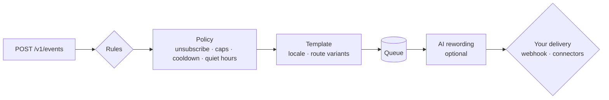

<div align="center">

# Cue

**The right message, at the right moment.**

A self-hosted notification decision engine. Your product reports what happened;<br/>
Cue decides who to tell, what to say, when, and over which route — then hands a
ready-to-send message to the delivery you plug in.

[](https://github.com/murtazox04/Cue/actions/workflows/ci.yml)
[](pyproject.toml)
[](LICENSE)

[Documentation](https://murtazox04.github.io/Cue) ·
[Getting started](docs/getting-started.md) ·
[Architecture](docs/architecture.md)

</div>

---

Cue sits between your product and your users' attention. Your backend reports what
happened — `order.shipped`, `payment.failed`, `trial.ending` — and Cue decides whether a
notification is warranted, which template and language to use, when to send it in the
recipient's time zone, and which route to try first. It renders the message and hands it
to whatever delivery you connect: your own service, a webhook, or a ready-made connector.

**Delivery is pluggable. The decisions are Cue's job** — and every one of them is
recorded, so "why didn't this user get the message?" becomes a query, not an
investigation.

```bash
curl -X POST https://cue.example.com/v1/events \
  -H "Authorization: Bearer $CUE_KEY" -H "Content-Type: application/json" \
  -d '{"name": "order.shipped", "recipient": "customer-42",
       "data": {"order_id": "1001"}, "idempotency_key": "order-1001-shipped"}'
```

Your delivery endpoint then receives a signed, fully rendered message:

```json
{
  "id": "01a1…",
  "channel": "push",
  "address": "<device token>",
  "locale": "en",
  "content": {"title": "Your order is on its way", "body": "Order 1001 ships today.",
              "url": "https://shop.example/orders/1001"},
  "metadata": {"cue_message_id": "01a1…", "cue_tracking_token": "…"}
}
```

## What Cue decides

- **Whether** — rules with JSON Logic conditions, priorities, wildcards, deterministic
  rollouts and a dry-run endpoint; unsubscribes, frequency caps, cooldowns and
  deduplication applied to every message; fatigue that backs off from people who stopped
  paying attention.
- **What** — localised, sandboxed Jinja2 templates with per-route variants (a short SMS,
  a rich e-mail), versioning and previews; optional AI rewording through any
  [Pydantic AI](https://ai.pydantic.dev) model, with guardrails that keep numbers and
  links verbatim.
- **How often** — digests that turn a burst of events into one message per window
  ("Ann, Bo and 10 others commented"), optionally summarised by AI, plus thread ids so
  phones and mail clients stack related messages.
- **When** — delays, quiet hours in each recipient's time zone, scheduled broadcasts,
  expiry for messages that go stale, and importance levels phones understand.
- **Who decides** — the person: a hosted preference page (or a JSON API for your own),
  RFC 8058 one-click unsubscribe for Gmail and Yahoo, and a consent ledger of every
  change.
- **Where** — an ordered list of routes per rule (e.g. push, then SMS), every address a
  person has on a route, fallback on permanent failure, retries on transient failure,
  dead addresses disabled automatically.

## Bring your own delivery

Each route (`push`, `sms`, `email`, `ops-alerts`…) is backed by a **connector**:

| Connector | Use it when |
|---|---|
| `webhook` | You already have a sending service, or want full control. Cue POSTs signed JSON to it. |
| `fcm`, `twilio`, `smtp`, `telegram` | You want a ready-made connector for these providers. |
| `console` | Local development. |
| your own | Write a small class and register it as a plugin — see [custom connectors](docs/guides/custom-channels.md). |

Connectors are configuration, not code changes — swap SMS vendors without touching a
rule.

## Also

- **Engagement tracking** — delivered, opened, clicked, converted; client apps report
  with a per-message token, no API key needed.
- **Broadcasts** — audience filters, resumable batches, pause/resume/cancel without
  double sends.
- **AI agents** — an MCP server (`cuectl mcp`) lets Claude, Cursor or your own agents
  notify people and inspect delivery within the scopes you grant.
- **Simple to run** — one Python service and PostgreSQL (or SQLite). No Redis, no
  broker, no cron: the durable job queue lives in your database.
- **Observable** — per-rule event outcomes, status reasons, Prometheus metrics, JSON logs.

## Quick start

```bash
git clone https://github.com/murtazox04/Cue && cd Cue
docker compose up --build -d
docker compose exec api cuectl keys create admin   # prints an API key
open http://localhost:8000/docs
```

Or with Python 3.12+:

```bash
pip install 'cue-notify[postgres]'
export CUE_WORKER__EMBEDDED=true CUE_CHANNELS__PUSH__PROVIDER=console
cuectl db upgrade && cuectl keys create admin && cuectl serve
```

Then follow the [getting-started guide](docs/getting-started.md).

## How it works



| Concept | In one line |
|---|---|
| **Event** | Something that happened to a recipient. Idempotent, stored with per-rule outcomes. |
| **Rule** | When event X (and condition) → send template Y over routes [A, B]. |
| **Template** | Localised content with route-specific variants. |
| **Category** | Policy bundle: frequency caps, quiet hours, whether unsubscribing is allowed. |
| **Channel** | A named route (`push`, `sms`…) backed by a connector. |
| **Message** | One notification to one recipient, with a full status trail. |
| **Broadcast** | One template to an audience, in resumable batches. |

## Configuration

Environment variables (`CUE_SECTION__KEY`) or a `cue.toml`:

```toml
[database]
url = "postgresql+asyncpg://cue:secret@db/cue"

[channels.push]
provider = "webhook"
url = "https://notifications.internal.example/push"
# secret from CUE_CHANNELS__PUSH__SECRET

[channels.sms]
provider = "twilio"
account_sid = "AC…"
from_number = "+15550100"   # auth token via CUE_CHANNELS__SMS__AUTH_TOKEN
```

See the [configuration reference](docs/reference/configuration.md) and
[`examples/cue.toml`](examples/cue.toml).

## Project status

Cue is in early development (0.x): the model and API are stable in shape but may still
change before 1.0. See the [roadmap](ROADMAP.md) for what comes next. Feedback and
contributions are very welcome — see [CONTRIBUTING.md](CONTRIBUTING.md).

## License

[MIT](LICENSE)
