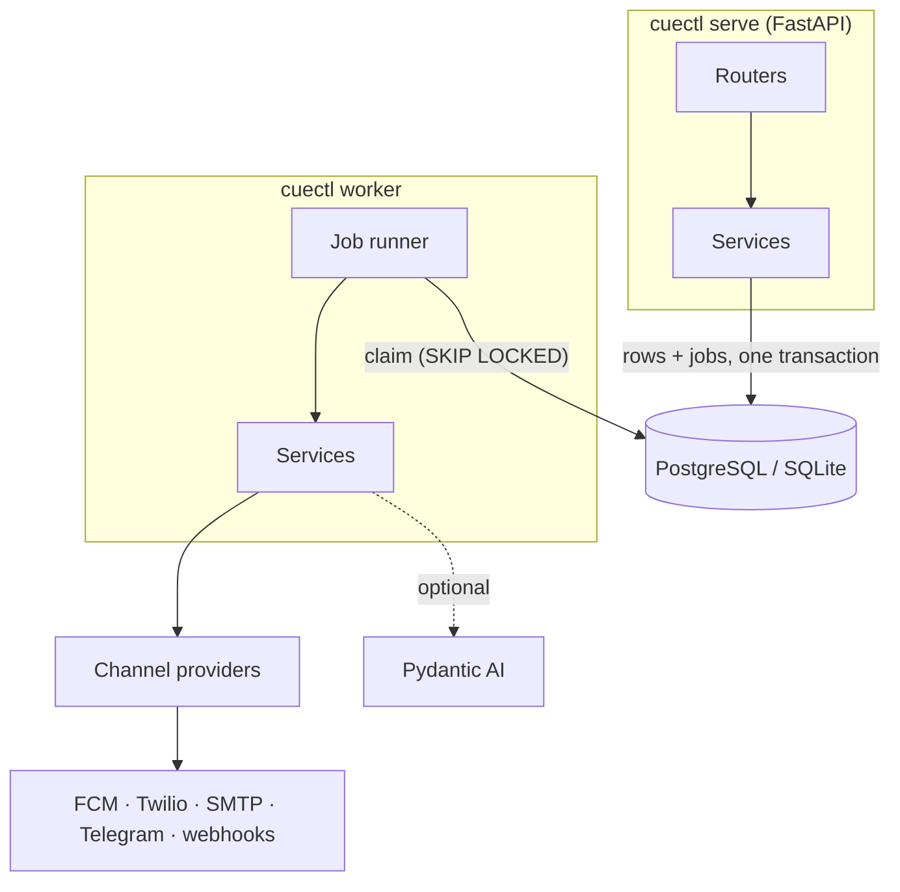
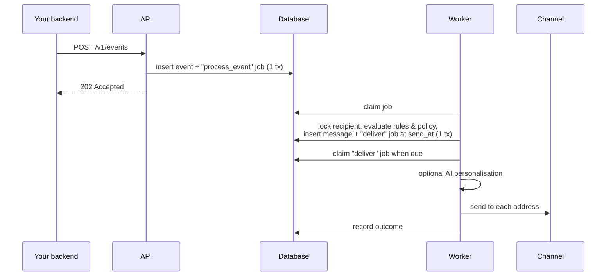

# Architecture

## Components

| Package | Responsibility |
|---|---|
| `cue_notify.core` | Pure logic, no I/O: JSON Logic, templating, quiet hours, locales, rollout, content models. |
| `cue_notify.db` | SQLAlchemy models, portable types, Alembic migrations. |
| `cue_notify.queue` | Durable job queue on the application database. |
| `cue_notify.services` | Use cases: ingest, evaluate, compose, deliver, broadcast, engagement. |
| `cue_notify.channels` | Provider contract, built-in providers, plugin registry. |
| `cue_notify.ai` | Personalisation contract, guardrails and the Pydantic AI implementation. |
| `cue_notify.api` / `cue_notify.cli` | Thin adapters over services. |
| `cue_notify.runtime` | Long-lived resources (engine, HTTP client, channels, generator) shared by all entry points. |

## The life of an event

## Design decisions

**The database is the queue.** Jobs are rows written in the same transaction as the data
they act on (transactional outbox), so there is no window where an event exists without
its processing job or a message without its delivery. Delays and quiet hours are a
future `run_at`, which survives restarts without a separate scheduler. Workers claim
with `SELECT … FOR UPDATE SKIP LOCKED` and a conditional update that doubles as a lease;
crashed workers' jobs reappear when the lease expires. This removes Redis and a broker
from the deployment at the cost of throughput in the low thousands of jobs per second
per database — far beyond what notification volumes need.

**One composer.** Rules, direct sends and broadcasts all build an *intent* and pass it
to `services.composer`. Policy cannot be bypassed by adding a new way to send.

**Policy is serialised per recipient.** Composing locks the recipient row, so caps and
cooldowns are exact under concurrency. On SQLite, `BEGIN IMMEDIATE` provides the same
guarantee by serialising writers.

**Decisions are data.** Suppressed and failed messages are stored with reasons; events
store per-rule outcomes. Debugging is a query, not a log search.

**Render early, personalise late.** Templates render when the message is composed (so
errors surface immediately and content is auditable); AI personalisation runs at send
time, after policy, so tokens are never spent on messages that will not be sent.

**Idempotency everywhere.** Events dedupe on `(source, idempotency_key)`; messages on
`dedup_key` (`event:<id>:<rule>`, `broadcast:<id>:<recipient>`, `api:<key>:<key>`); jobs
on `key`. Every job handler re-checks state before acting, so at-least-once execution
is safe.

**UUIDv7 keys.** Time-ordered identifiers keep indexes compact and double as stable
pagination cursors.

**Plugins over configuration flags.** Channels are classes discovered through entry
points, configured by name. Adding a provider never touches the core.
