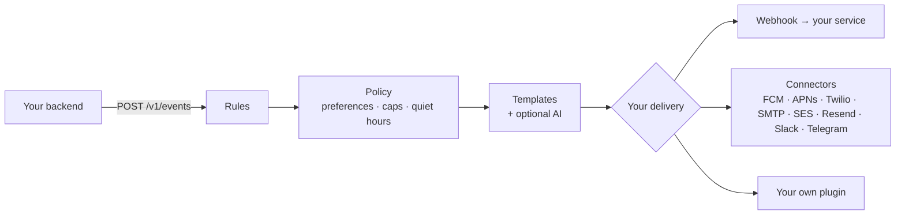

# Cue

**Per-person attention budgets for AI agents and background automations, self-hosted.**

A code-review agent, a log-triage agent and a billing agent can all page the same
engineer at 2 a.m. A LangGraph `interrupt()` or a Slack approve button pauses one agent;
none of them knows what the others already sent. Cue sits in front of all of them as
the outbound gatekeeper:

- **Budgets per agent, per person.** Each agent sends with its own key. Its
  `frequency_caps` limit how many messages it may send one person per period, and
  messages over budget are stored as `suppressed` with reason `agent_budget`. Category
  caps count what a person gets from every sender together. See [agents](concepts/agents.md).
- **Quiet hours in the person's time zone.** A message due inside someone's quiet hours
  waits until they end. Only `critical` messages in categories people cannot unsubscribe
  from break through, and each agent's `max_importance` caps what it may claim, so only
  agents you trust can use `critical`. See [delivery policy](concepts/policy.md).
- **Digests for the rest.** A [digest](concepts/digests.md) rule turns a stream of agent
  events into one message per window, or one per day at a local time.
- **Approval for risky messages.** Messages that match an agent's `approval` condition
  wait as `pending_approval`; a reviewer decides from a one-time link in their own
  notification. Agent keys can never approve. See [approval](concepts/agents.md#approval).
- **A reason for every outcome.** Each message has a status and a `status_reason`, and
  each event records which rules matched and why. Agents connect over HTTP, the SDKs or
  the [MCP server](guides/ai-agents.md).

The recording is
[`examples/agents-demo`](https://github.com/murtazox04/Cue/tree/main/examples/agents-demo):
from a checkout, `uv run python examples/agents-demo/demo.py` runs it with SQLite and
the console connector.

## Your own product's notifications

The same policy serves your product's notifications. Your product and your agents
report what happened; Cue decides whether it is worth a notification, what to say, when
and over which route, renders a ready-to-send message, and hands it to the delivery you
plug in: your own service through a signed webhook, or a ready-made connector.

### Why Cue?

Most products start with `send_push(user, "Your order shipped")` sprinkled through the
codebase. It works until it doesn't: people get five notifications at 3 a.m., marketing
ignores unsubscribes, one dead device token fails a whole job, and nobody can answer
*"why didn't this user get the message?"*.

Cue moves that logic into one place:

- **Events, not sends.** Your code emits facts (`order.shipped`); rules decide what to send.
  Change messaging without redeploying your product.
- **Policy everywhere.** Every message — rule-triggered, direct or broadcast — passes the
  same checks: unsubscribes, muted channels, frequency caps, cooldowns and quiet hours in
  the recipient's own time zone.
- **Fewer, better messages.** [Digests](concepts/digests.md) turn a burst of events
  into one message ("Ann, Bo and 10 others commented"), automatically or summarised by
  AI, and thread ids let phones and inboxes stack related messages.
- **People in control.** A [preference centre](concepts/preferences.md), hosted or
  headless, one-click unsubscribe as Gmail and Yahoo require, and a consent ledger
  recording who changed what, and when.
- **Bring your own delivery.** Cue does not lock you into a provider. Point a route
  at your existing sending service with a signed webhook, use a bundled connector, or
  write your own in a few dozen lines.
- **Reliable routing.** Multiple devices per person, channel fallback (push → SMS),
  retries with backoff, automatic removal of dead tokens, at-least-once jobs that are
  safe to retry.
- **Answers, not guesses.** Every event records which rules matched and why; every message
  records its status and the reason it was suppressed or failed.
- **AI that cannot lie about money.** Optional personalisation through any major model
  provider, constrained to rephrasing: numbers and links must survive verbatim, and only
  attributes you allow-list are ever sent to the model.
- **Agent-ready.** An [MCP server](guides/ai-agents.md) lets AI agents send
  notifications and inspect delivery with scoped credentials.
- **Runs on your database.** An API process and a worker process (or the worker
  embedded in the API) with PostgreSQL or SQLite. No Redis or message broker: the job
  queue lives in the database. Retention (`cuectl prune`) is a command you schedule.

## Next steps

- [Getting started](getting-started.md): run Cue locally and see a message delivered.
- [Agents](concepts/agents.md): give each agent its own key, budget and approval rule.
- [Events and rules](concepts/events-and-rules.md): the core model.
- [Deployment](guides/deployment.md): production checklist.
