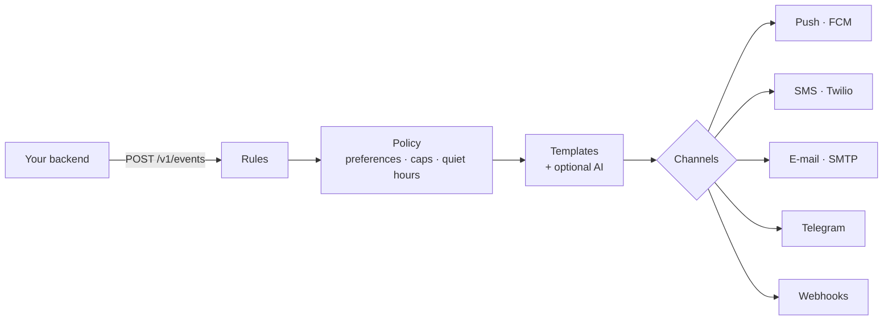

# Cue

**Self-hosted notification orchestration.** Your product reports what happened; Cue
decides whether, when, where and what to tell each person — and then makes sure it gets
there.

## Why Cue?

Most products start with `send_push(user, "Your order shipped")` sprinkled through the
codebase. It works until it doesn't: people get five notifications at 3 a.m., marketing
ignores unsubscribes, one dead device token fails a whole job, and nobody can answer
*"why didn't this user get the message?"*.

Cue moves that logic into one place:

- **Events, not sends.** Your code emits facts (`order.shipped`); rules decide what to send.
  Change messaging without redeploying your product.
- **Policy everywhere.** Every message — rule-triggered, direct or broadcast — passes the
  same checks: unsubscribes, muted channels, frequency caps, cooldowns and quiet hours in
  the recipient's own time zone.
- **Reliable delivery.** Multiple devices per person, channel fallback (push → SMS),
  retries with backoff, automatic removal of dead tokens, at-least-once jobs that are
  safe to retry.
- **Answers, not guesses.** Every event records which rules matched and why; every message
  records its status and the reason it was suppressed or failed.
- **AI that cannot lie about money.** Optional personalisation through any major model
  provider, constrained to rephrasing: numbers and links must survive verbatim, and only
  attributes you allow-list are ever sent to the model.
- **Simple to run.** One Python service and PostgreSQL (or SQLite). No Redis, no message
  broker, no cron — the job queue lives in your database.

## Next steps

- [Getting started](getting-started.md) — running locally in five minutes.
- [Events and rules](concepts/events-and-rules.md) — the core model.
- [Deployment](guides/deployment.md) — production checklist.
